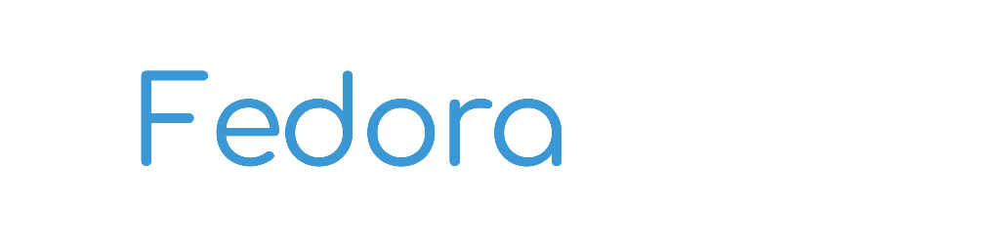

  

### A fast, elegant, and distraction-free YouTube & music streaming client for Android.

---

## ✨ Features

### Shorts-free
- **No Shorts, ever** — Shorts shelves and feeds are stripped out across the whole app.
- **Anti-doomscroll** — long-form, high-value content without algorithmic distraction.

### Focus Mode
- **Search-first canvas** — a clean, distraction-free screen centered on discovery and playback.
- **No algorithmic clutter** — suppress noisy home feeds when you just want to find something.

### Music Hub
- **Trending & charts** — daily trending tracks, Global Top 100 and top artists worldwide.
- **Synced lyrics** — real-time lyrics with quick album-art flipping while you sing along.
- **Lockscreen artwork** — dynamic artwork on the lockscreen and player background.

### Player
- **SponsorBlock** — automatically skip sponsored segments, intros, outros and subscription reminders.
- **Background play & PiP** — audio keeps playing with the screen off or in picture-in-picture.

---

## 🔒 Privacy

FedoraTube has **no account system, no analytics, no crash reporting and no advertising identifier**. Watch history, subscriptions, playlists and recommendations live in a local database on your device and leave it only if you start a backup export or a device-to-device sync over your own local network.

Full details: **[privacy.md](privacy.md)**

---

## 📄 License

This project is Free and Open Source Software distributed under the **[GNU General Public License v3 (GPLv3)](License)**.
In accordance with GPLv3, all source code and derivative modifications remain completely open and freely accessible.

Copyright © 2026 **FedoraTube Contributors**
