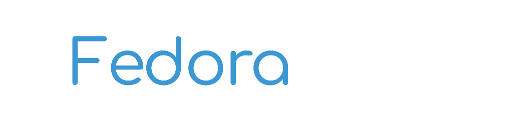
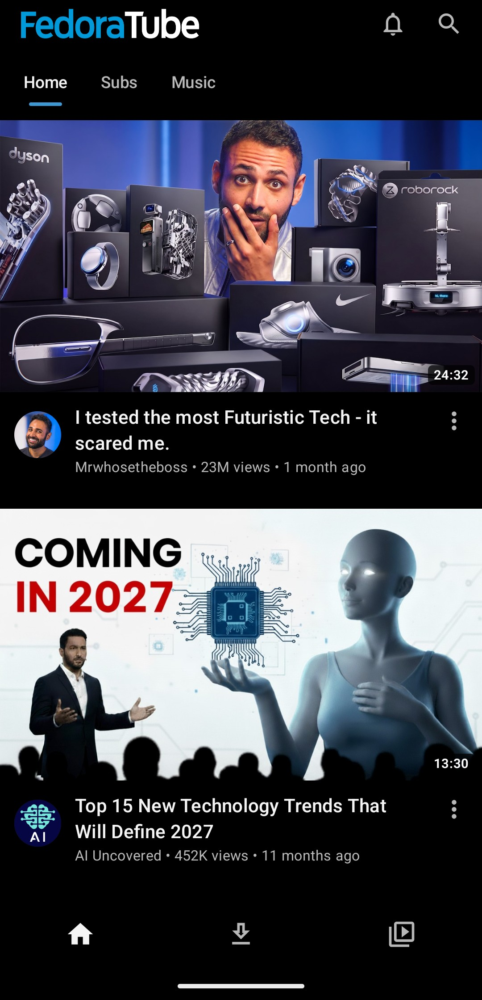
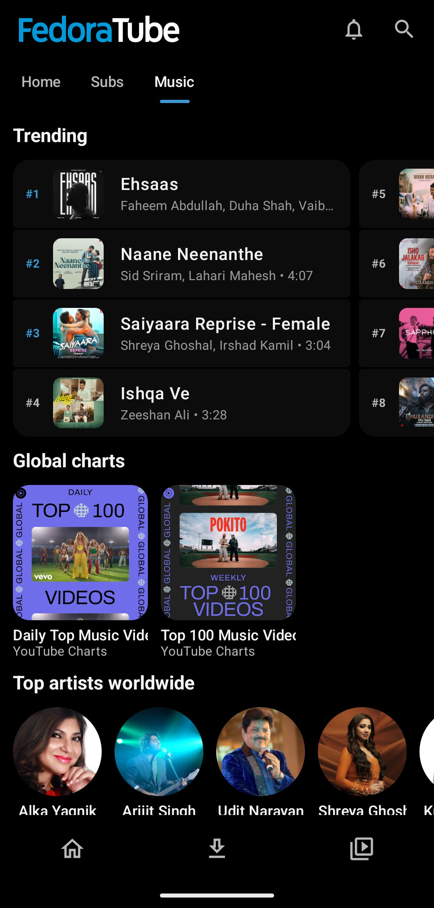
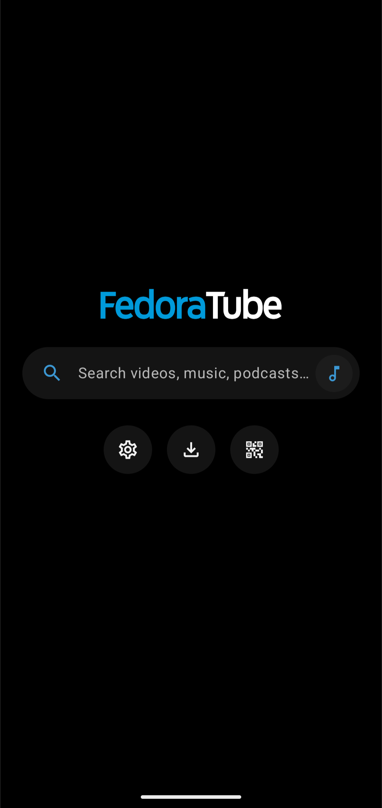

<div align="center">



<br><br>

### A fast, elegant, and distraction-free YouTube & music streaming client for Android.

[](https://github.com/muhammadmarowan/FedoraTube/releases)
[](https://github.com/muhammadmarowan/FedoraTube/releases)
[](#-100--shorts-free)
[](License)

<br>

[⬇️ Install](#-install) &nbsp;&nbsp;·&nbsp;&nbsp; [✨ Features](#-features) &nbsp;&nbsp;·&nbsp;&nbsp; [📱 Screenshots](#-screenshots) &nbsp;&nbsp;·&nbsp;&nbsp; [🔒 Privacy](#-privacy) &nbsp;&nbsp;·&nbsp;&nbsp; [📄 License](#-license)

</div>

---

## 📱 Screenshots

<div align="center">
  <table>
    <tr>
      <td align="center" width="25%">
        <b>Home</b><br>
        <sub>Subscription & recommendation feed</sub><br><br>
        
      </td>
      <td align="center" width="25%">
        <b>Music</b><br>
        <sub>Trending, global charts & top artists</sub><br><br>
        
      </td>
      <td align="center" width="25%">
        <b>Search</b><br>
        <sub>Minimal search-first canvas</sub><br><br>
        
      </td>
      <td align="center" width="25%">
        <b>Player</b><br>
        <sub>Comments, actions & related videos</sub><br><br>
        
      </td>
    </tr>
  </table>
</div>

---

## ✨ Features

<table>
  <tr>
    <td width="50%">

### 🚫 100% Shorts-free
- **No Shorts, ever** — Shorts shelves and feeds are stripped out across the whole app.
- **Anti-doomscroll** — long-form, high-value content without algorithmic distraction.

### 🎯 Focus Mode
- **Search-first canvas** — a clean, distraction-free screen centered on discovery and playback.
- **No algorithmic clutter** — suppress noisy home feeds when you just want to find something.

### 🎵 Music Hub
- **Trending & charts** — daily trending tracks, Global Top 100 and top artists worldwide.
- **Synced lyrics** — real-time lyrics with quick album-art flipping while you sing along.
- **Lockscreen artwork** — dynamic artwork on the lockscreen and player background.

### ⚡ Player
- **SponsorBlock** — automatically skip sponsored segments, intros, outros and subscription reminders.
- **Background play & PiP** — audio keeps playing with the screen off or in picture-in-picture.
- **Quality & speed control** — pick resolution, playback speed and double-tap seek behavior.

    </td>
    <td width="50%">

### 🔒 Private by design
- **No account, no tracking** — no Google login, no analytics, no telemetry, no ads. See [privacy.md](privacy.md).
- **On-device recommendations** — your watch habits are computed locally and never leave your phone.
- **Backup & restore** — export and import subscriptions, history and playlists anytime.

### 📲 Share with anyone
- **Share-app QR** — always points at the newest release, prereleases included.
- **Quick Share** — send the installed APK to a nearby phone over the system Sharesheet, no internet needed.

### 🔔 Smart updates
- **What's-new notification** — update notifications preview the first lines of the changelog; expand for the rest.
- **In-app updater** — check for, download and install updates without leaving the app.

### 🌍 Made for everyone
- **30 languages** — fully translated UI, from Arabic to Vietnamese.
- **Lightweight** — five ABI builds (universal, arm64-v8a, armeabi-v7a, x86, x86_64) so you only download what your device needs.

    </td>
  </tr>
</table>

---

## ⬇️ Install

Download the latest APK from the **[Releases page](https://github.com/muhammadmarowan/FedoraTube/releases)**:

| APK | For |
|---|---|
| `app-github-universal-release.apk` | Any device — safest choice |
| `app-github-arm64-v8a-release.apk` | Modern phones (most devices since ~2017) |
| `app-github-armeabi-v7a-release.apk` | Older 32-bit phones |
| `app-github-x86_64-release.apk` | x86_64 emulators & devices |
| `app-github-x86-release.apk` | x86 emulators |

- **Requires Android 8.0 (API 26) or newer.**
- Updates are announced in-app and via notification — install once and you will never miss a release.

<details>
<summary><b>Building from source</b></summary>

```bash
git clone https://github.com/muhammadmarowan/FedoraTube.git
cd FedoraTube
./gradlew :app:assembleGithubRelease
```

APKs land in `app/build/outputs/apk/github/release/`. CI also runs on every push and publishes the same artifacts.

</details>

---

## 🔒 Privacy

FedoraTube has **no account system, no analytics, no crash reporting and no advertising identifier**. Watch history, subscriptions, playlists and recommendations live in a local database on your device and leave it only if you start a backup export or a device-to-device sync over your own local network.

Full details: **[privacy.md](privacy.md)**

---

## 📄 License

This project is Free and Open Source Software distributed under the **[GNU General Public License v3 (GPLv3)](License)**.
In accordance with GPLv3, all source code and derivative modifications remain completely open and freely accessible.

Copyright © 2026 **FedoraTube Contributors**
