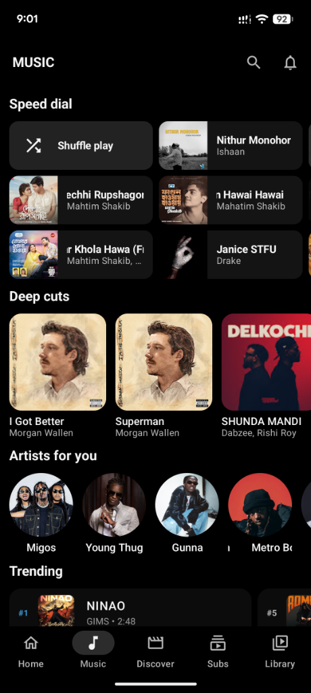

# Fedora Tube

 

 

---

## ⚡ Highlights & Features

### 🎬 Ad-Free Video Streaming
* **Zero Commercials & Trackers:** Watch videos without pre-roll, mid-roll, or banner ads.
* **Integrated SponsorBlock:** Automatically skip sponsored segments, intros, outros, and subscribe reminders.
* **Background & PiP:** Keep playing audio in the background with the screen turned off or in Picture-in-Picture window mode.

### 🎵 Dedicated Music Experience
* **YouTube Music Engine:** Explore trending tracks, global top charts, artist discographies, and mood radios.
* **Rich Audio Player:** Enjoy background audio, lock screen controls, and synchronized real-time lyrics.

### 🔒 100% Private & Offline First
* **Local Taste Engine:** Personal recommendations are computed entirely on your device. Your watch habits never get uploaded to any cloud.
* **No Account Required:** No Google login needed. Import/export your subscriptions and watch history anytime.

## 📱 Screenshots

  <table>
    <tr>
      <td align="center" width="25%">
        <b>Home Feed</b> 
        
      </td>
      <td align="center" width="25%">
        <b>Music Hub</b> 
        
      </td>
      <td align="center" width="25%">
        <b>Video Player</b> 
        
      </td>
      <td align="center" width="25%">
        <b>Focus Mode</b> 
        
      </td>
    </tr>
  </table>

---

## 🙏 Acknowledgments & Credits

**Fedora Tube** is based on and built upon the wonderful work of the **[Flow-Tube/Flow](https://github.com/Flow-Tube/Flow)** project created by **[A-EDev](https://github.com/A-EDev)** and its open-source contributors. 

We extend our sincere thanks and heartfelt gratitude to the Flow development team for creating such an innovative, privacy-first video streaming platform and on-device recommendation algorithm. 

---

## 📄 License & Open Source

This project is Free Software distributed under the **GNU General Public License v3 (GPLv3)**.  
In accordance with GPLv3, all source code and derivative modifications remain completely open and freely accessible.

Copyright © 2026 **Fedora Tube**  
Original Flow-Tube codebase Copyright © 2025–2026 **A-EDev**

